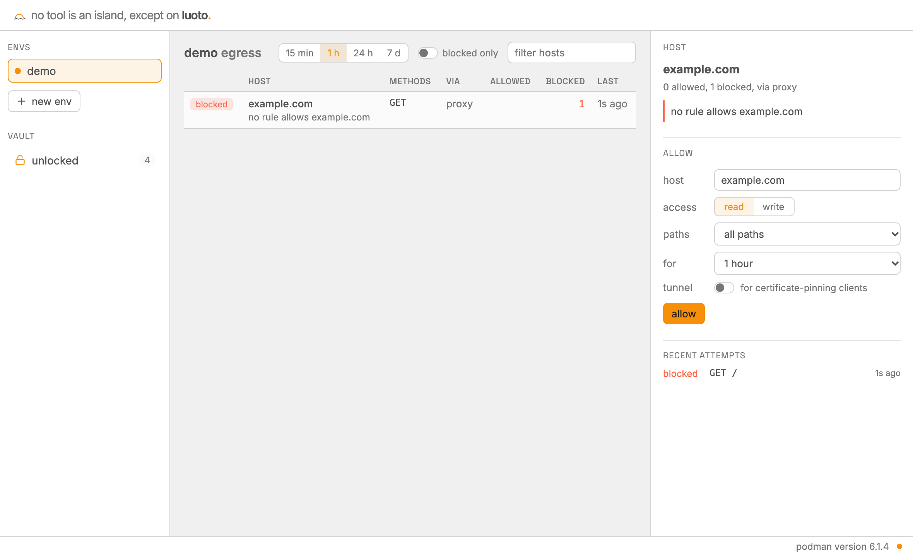
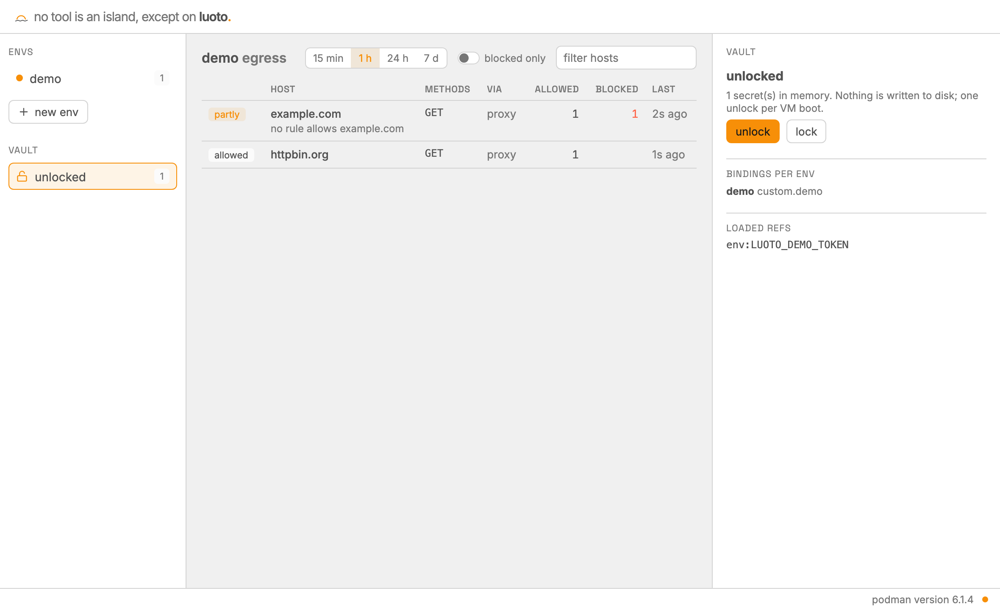
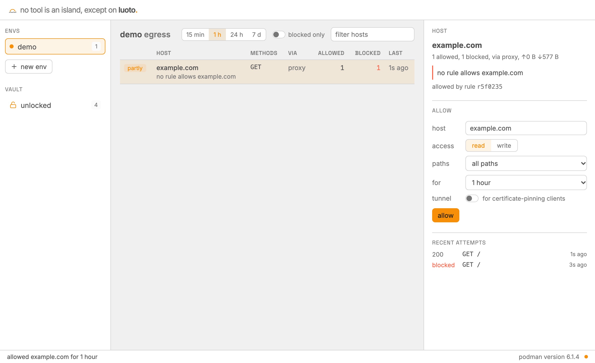
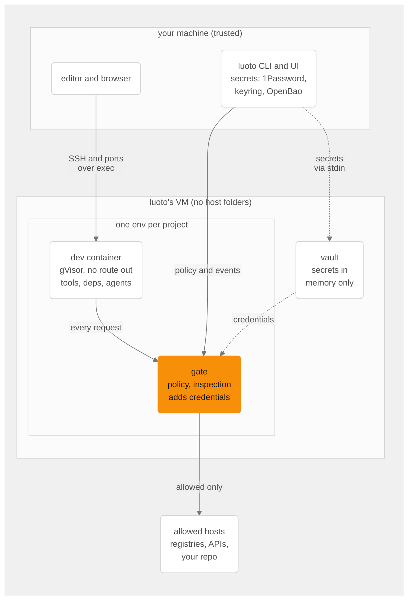

<p align="center">
  <picture>
    <source media="(prefers-color-scheme: dark)" srcset="docs/logo/luoto-dark.svg">
    
  </picture>
</p>

## Why

A malicious package runs with everything you have. Its install script can read `~/.ssh`,
your cloud and npm tokens and your other repos, send them anywhere, and — as worms like
Shai-Hulud did — use your GitHub token to publish itself further. Coding agents run more code,
faster, often with their permission prompts off.

luoto gives each project a sandbox where that doesn't work:

- **It can't see your files.** The project is copied in; your home folder, SSH keys and other
  repositories stay on your machine.
- **It reaches only what you allowed.** Every request leaves through a gate with per-host
  rules, read-only unless you say otherwise. Anything else is blocked and shown to you, with a
  one-click allow.
- **Your secrets never enter it.** Agent, GitHub and Azure DevOps tokens stay in a vault
  outside the sandbox; the gate adds them to the requests you allowed, and code inside sees
  placeholders. Git tokens work only for the repositories you named.

You keep working as usual: your editor attaches over SSH, agents run with their prompts off
because the sandbox is the boundary, and work leaves as a pull request.

Something in an env tried to reach `example.com`. The gate blocked it, and `luoto ui` shows
the attempt with a scoped allow next to it:

<picture>
  <source media="(prefers-color-scheme: dark)" srcset="docs/screenshots/egress-blocked-dark.png">
  
</picture>

> luoto is a personal hobby project in beta, maintained on a best-effort basis.

## Install

| platform                                     | install                                                                                           |
| -------------------------------------------- | ------------------------------------------------------------------------------------------------- |
| macOS, Linux                                 | `curl -fsSL https://raw.githubusercontent.com/eetu/luoto/main/install.sh \| sh`                   |
| macOS, Linux (Homebrew)                      | `brew install eetu/tap/luoto` (a full name trusts that formula only)                              |
| Linux, no script                             | a `.tar.gz` from [Releases](https://github.com/eetu/luoto/releases), checked against `SHA256SUMS` |
| from source                                  | `just install-cli`, then `luoto setup --build`                                                    |
| Windows (Scoop; not yet verified end to end) | `scoop bucket add luoto https://github.com/eetu/scoop-luoto` then `scoop install luoto`           |

Then, once:

```sh
luoto setup
```

It checks your container runtime (podman ≥ 5.2 or Docker ≥ 28; `--install` installs podman
after showing the command), creates luoto's own VM where podman needs one, and gets the
images. Updates, tab completion and checking a download: [Install details](#install-details).

## A first session: from folder to pull request

### 1. Make an env for a project

```console
$ cd ~/dev/my-app
$ luoto init
env `my-app` from ~/dev/my-app
  workspace  copy: the env works on its own copy; changes leave by git push or `luoto pull`
  isolation  gVisor: its own user-space kernel (builds about 1.6× slower)
  presets    debian, github, toolchains, npm (package.json)
  toolchains node 24 (.nvmrc)
             installed by mise in the env; the project's files keep deciding versions

Create it? [Y/n/c = customize]
```

luoto read the folder before creating anything: node 24 from `.nvmrc`, the npm registry
because of `package.json`. `Y` copies the folder, git history included, into the env and
starts it; your folder stays as it was. `c` goes through the settings one at a time.

### 2. Give it credentials, without giving them to it

Two tokens: one for Claude Code (`claude setup-token` on your machine uses your Claude
subscription) and a fine-grained GitHub token for this repository only, with Contents and Pull
requests set to read and write. Keep both in your secret store and point the env at them with
`luoto edit`:

```toml
[credentials.anthropic]
oauth_token = "op://Private/claude-code/token"

[credentials.github]
token = "op://Private/github-my-app/token"
repos = ["you/my-app"]
protected_branches = ["main"]
```

Saving applies it. luoto reads the secrets on your machine and hands them to the vault, which
lives outside the sandbox. Inside, `GH_TOKEN` and Claude's token are placeholders; the gate
puts the real ones on requests to GitHub and Anthropic, for `you/my-app` only, and refuses
pushes to `main`. No secret store? `luoto agent add claude` asks for the token and keeps it in
your OS keychain.

`luoto ui` shows which credentials an env has, never their values:

<picture>
  <source media="(prefers-color-scheme: dark)" srcset="docs/screenshots/vault-dark.png">
  
</picture>

### 3. Let an agent work

```sh
luoto agent add claude          # installs Claude Code in the env
luoto agent run claude --yolo   # no permission prompts: the sandbox is the boundary
```

Ask it to fix something small and open a pull request. Or do it yourself: `luoto open`
attaches Zed, VS Code or Cursor over SSH, and `luoto shell` opens a terminal.

### 4. Run it and open it

Start the project as usual in the env's terminal: `yarn dev` prints
`http://localhost:5173/`, and clicking it opens the app in your browser. A background watcher
(started by `up`, `shell` and editor sessions) forwards each port a server in the env listens
on, 1024–32767, to the same port on your machine for as long as it listens. It goes through
the runtime rather than a network path, so servers bound to the env's own localhost work too;
a port already taken here is skipped (`luoto forward LOCAL:ENV` maps it elsewhere).

### 5. See what it reached

`luoto ui` (or `luoto egress`) lists every host the env tried: npm and GitHub allowed,
anything else blocked, with a scoped allow next to it. One click lets a host through, for an
hour if you like:



An agent that needs a host asks with `sandbox request`; only you can approve it, on your
machine (`luoto approve`, which asks you to accept the rule's risks like `luoto allow` does;
`--force` accepts them without asking).

### 6. Bring files back and stop

`luoto pull` brings files back to your folder when you need them there; it holds back git
hooks and other files your own tools would run. `luoto down` stops the env, and it stops by
itself after 30 minutes with nothing running in it (`idle_stop`); luoto's VM stops once no
env has run for as long. `luoto up` brings it back in about 10 s and unlocks the vault anew.

## Day to day

Commands act on the env of the current folder; `-e NAME` picks another (`luoto status -e web`).

| you want                                                                                             | run                                                                                                                                |
| ---------------------------------------------------------------------------------------------------- | ---------------------------------------------------------------------------------------------------------------------------------- |
| an env for a folder (copied in)                                                                      | `luoto init [DIR]`                                                                                                                 |
| a new project (the folder is created)                                                                | `luoto init ~/dev/new-app`                                                                                                         |
| to review, apply or ignore the team's `luoto.toml`                                                   | `luoto project`<br>`luoto project apply`<br>`luoto project ignore`                                                                 |
| your editor, or a shell                                                                              | `luoto open`<br>`luoto open --with code`<br>`luoto shell`                                                                          |
| to see what the sandbox tried to reach                                                               | `luoto egress --since 10m`<br>`luoto egress --denied`<br>`luoto egress --follow`                                                   |
| to allow a host (read-only unless `--write`)                                                         | `luoto allow docs.rs --ttl 1h`<br>`luoto allow api.example.com --write --path '/v1/**'`<br>`luoto allow grpc.example.com --tunnel` |
| to see or remove rules                                                                               | `luoto status`<br>`luoto revoke <id-or-host>`                                                                                      |
| to answer access requests from inside                                                                | `luoto requests`<br>`luoto approve 3 --ttl 1h`<br>`luoto reject 3`                                                                 |
| an agent (installed on first run)                                                                    | `luoto agent run claude --yolo`<br>`luoto agent list`                                                                              |
| a dev server in your browser                                                                         | run it: its port is forwarded to localhost here<br>`luoto forward 8080:5173` (to another local port)                               |
| your work out: push from the env (with a GitHub, Azure DevOps or SSH credential), or copy files back | `git push`<br>`luoto pull`                                                                                                         |
| image or config changes applied (volumes are kept)                                                   | `luoto up --recreate`                                                                                                              |
| to stop an env, or delete it with its volumes and config (your folder stays)                         | `luoto down`<br>`luoto rm`                                                                                                         |
| the env back after a reboot or an idle stop (unlocks the vault if needed)                            | `luoto up`<br>`luoto vault unlock`                                                                                                 |
| to check isolation                                                                                   | `luoto doctor`                                                                                                                     |

Inside the sandbox, `sandbox status` shows the policy and `sandbox request <host> --reason …`
asks you for access; only you can approve, on the host.

## Agents

`luoto agent run <agent>` installs the agent on first run, applies the env's current config and
starts the agent in `/workspace`; `--yolo` turns off its own permission prompts (OpenCode has no
flag for it), since the sandbox is the boundary. After that first run the command (`claude`,
`codex`, …) also works in any env terminal, including an editor's. Each agent needs a credential
for one of its providers under `[credentials.<provider>]`; the gate adds it to every request and
the sandbox sees only a placeholder. [docs/agents.md](docs/agents.md#credentials) covers where
to get one, how the prompt keeps it, and logins inside the sandbox, with the hosts and
verification status of each agent. `luoto agent list` shows agents and providers.

| agent                         | command    | credential                                                  |
| ----------------------------- | ---------- | ----------------------------------------------------------- |
| Claude Code                   | `claude`   | Claude subscription token (`claude setup-token`) or API key |
| OpenCode                      | `opencode` | Anthropic, OpenAI, OpenRouter or Gemini API key             |
| Codex                         | `codex`    | OpenAI API key, or a ChatGPT login inside                   |
| GitHub Copilot CLI (untested) | `copilot`  | fine-grained token with Copilot Requests                    |
| Antigravity CLI               | `agy`      | Google account, signed in inside the env                    |

## Configuration

`~/.config/luoto/envs/<name>.toml` (on Windows, `~/.config/luoto` is `%APPDATA%\luoto\config`
throughout). `luoto edit -e <name>` opens it in `$EDITOR` and applies it when you save; edited
any other way, it applies at the next `luoto up`. The UI adds and removes rules. `version` in
a config file is its format (1 when missing): luoto reads older formats and refuses a file
from a newer luoto.

```toml
presets = ["debian", "github", "toolchains", "npm"]   # see shared/presets/
agents = ["claude"]
ports = [5173]                # published by the gate itself (servers listening on all interfaces)
# isolation = "container"     # default gVisor; this shares the VM's kernel, builds ~1.6× faster
# idle_stop = "2h"            # default 30m; "off" disables
# auto_forward = false        # don't forward listening ports to localhost here

[tools]                       # default toolchains; the project's own version files win
node = "lts"

[workspace]
dir = "/Users/me/dev/web"     # the project folder, copied in on the first `up`

[[allow]]
host = "docs.rs"
paths = ["/serde/**"]         # /serde and below; `*` stays within one path segment
expires = "2026-12-01T00:00:00Z"

[credentials.github]          # a GitHub App: tokens minted per env, scoped to these repos
app_id = "123456"             # (or `token = "<ref>"` for a fine-grained token)
installation_id = 7890123
private_key = "op://Dev/luoto-github-app/private key"
repos = ["owner/repo"]
permissions = { contents = "write", pull_requests = "write" }
protected_branches = ["main"]

[credentials.azure_devops]    # Azure DevOps git over HTTPS
token = "op://Dev/ado/pat"    # a PAT with Code (Read & write)
repos = ["myorg/Project/repo"]   # `org/project/repo`, or the clone URL
protected_branches = ["main"]

[credentials.ssh]             # git over SSH: the vault keeps the key and signs logins
key = "op://Private/github-ssh/private key?ssh-format=openssh"
hosts = ["github.com"]        # GitHub's and Azure DevOps' host keys are pinned
# host_keys = ["git.example.com ssh-ed25519 AAAA…"]   # known_hosts lines for other hosts

[credentials.anthropic]       # or openai, openrouter, gemini, mistral, groq, copilot
oauth_token = "op://Private/claude-code/token"

[credentials.custom.stripe]   # any API: inject a header on one host
host = "api.stripe.com"
secret = "op://Dev/stripe-test/key"
placeholder_env = { STRIPE_API_KEY = "sk_test_luoto_placeholder" }   # what the code reads
# header = "authorization", format = "Bearer {secret}" are the defaults
write = true

[sandbox_secrets]             # deliberately exposed to code in the sandbox (env vars)
DATABASE_URL = "op://Dev/local-db/url"

[deps]                        # installed in the env on `up`
system = ["postgresql-client"]                  # apt / apk / dnf, whichever the image has
run = ["git config --global pull.rebase true"]  # as you, in your home; keep them repeatable
hosts = ["dl.k8s.io"]         # extra hosts readable only while installs run
```

`config.toml` takes `[tools]`, `[deps]`, `idle_stop` and `auto_forward` too, for every env; an
env's own come on top.

Secret refs: `op://…` (1Password CLI, desktop or service account), `vault://mount/path#field`
(OpenBao / HashiCorp Vault), `keyring:service/account` (OS keychain), `env:NAME`, `file:path`.
Sources are configured in `~/.config/luoto/config.toml`.

`[sandbox_secrets]` are resolved on your machine at `up` and written to a memory-only file in
the dev container that every shell loads; they leave with the container. Anything that only
needs a token in an HTTP header belongs under `[credentials.custom.<name>]` instead, where the
sandbox never sees it.

A GitHub App for luoto needs only repository permissions such as Contents and Pull requests;
luoto refuses Workflows, Actions, Secrets and Administration ([why](SECURITY.md#what-holds-the-line)).

An Azure DevOps credential lets the env fetch and push its repos over HTTPS. Remotes keep
working as they are: SSH ones (`git@ssh.dev.azure.com:v3/…`, or a host alias from your
`~/.ssh/config` that the folder's remotes use) and `*.visualstudio.com` ones are rewritten to
`https://dev.azure.com` in the env. Pull requests are opened in Azure DevOps itself.

An SSH credential lets git use SSH remotes as they are, to `hosts` on port 22 only. GitHub SSH
remotes go to HTTPS when github.com isn't in `hosts`, as do Azure DevOps ones with an Azure
DevOps credential; other forges' SSH remotes work only through `hosts`. SSH sessions are
unscoped by repository, so use a deploy key where that matters
([SECURITY.md](SECURITY.md#what-holds-the-line)). From 1Password, the key's ref is
`op://<vault>/<item>/private key?ssh-format=openssh`.

## Toolchains

The project chooses its toolchains, as it would on your machine: luoto runs
[mise](https://mise.jdx.dev) (asdf-compatible) in the env and has it read the project's
`mise.toml`, `.tool-versions`, `.node-version`/`.nvmrc`, `.python-version`, `.java-version`,
`.ruby-version`, `go.mod`, `rust-toolchain.toml` and `package.json` (`packageManager`, for
yarn and pnpm). Anything in mise's registry or an asdf/vfox plugin installs: node, python,
java, go, rust, php, ruby, terraform, ….

Terraform and OpenTofu are found by `.terraform-version`, `.opentofu-version`, `main.tf`,
`versions.tf`, `terraform.tf` (or `main.tofu`, `versions.tofu`) and `.terraform.lock.hcl`,
whose providers' registry tells the two apart; an exact `required_version` sets the version.
Their presets (`terraform`, `opentofu`) open the provider and module registry. Cloud credentials for `plan` and `apply` aren't handled yet
([ROADMAP.md](ROADMAP.md)).

- `luoto init` reads the folder first and shows what it found (toolchains with the file that
  pins each, presets for the registries it uses) before creating anything. It looks three
  levels into subfolders (a monorepo's `frontend/` and `backend/`), skipping ignored,
  dependency, build and hidden folders. A runtime the project needs but pins nowhere gets a
  default: Rust stable, node LTS or Python 3.14. `c` goes through the settings one at a time
  (isolation, presets, toolchains, agents and their credentials, ports); `--preset` and
  `--tool node=24` override what it detected. A new or empty folder has nothing to detect, so
  `init` starts with those settings; `luoto up` in a folder without an env offers the same.
  `luoto init` again in an env's folder offers what the project suggests now and the env lacks
  (it only adds).
- `up` installs whatever the project now pins and the env lacks, in every folder that pins
  something (checked offline, so it is quick when nothing changed). `[tools]` in the env or
  `config.toml` gives defaults for tools the project doesn't pin; your own `~/.config/mise`
  (via `~/.config/luoto/home/`) sits in between.
- A runtime the project names only in prose, such as Java for a pyspark project, goes in with
  `luoto init --tool java=21` (or `java = "21"` under the env's `[tools]`): mise installs
  Temurin 21, and `corretto-21` or `zulu-21` pick another vendor. A committed `.java-version`
  or `mise.toml` gives it to every clone.
- Inside the env, you or an agent add a language with `mise use go@1.23` (it writes
  `mise.toml`). The `toolchains` preset, on by default, lets runtime downloads through: mise
  metadata and the vendors' download servers, read-only. Without it, `up` grants it only while
  installing.
- When an install is denied a host the presets don't know, `up` lists it and offers to allow
  it for installs (saved to `[deps] hosts`).

No runtime is baked into luoto-base. `npm i -g` and `pipx` install into `~/.local/bin`, which
persists with the home volume, as do mise's toolchains.

Verified by hand, from `luoto init` to a build or test run in the env: npm, Yarn 1 and 4, pnpm,
pip, uv, Poetry, Cargo, Go, Java (pyspark with `--tool java=21`), Terraform and OpenTofu
(`init` and `plan`), and a Rust + Yarn + uv monorepo. Other toolchains mise installs are untested ([ROADMAP.md](ROADMAP.md)).

## Team settings: `luoto.toml`

A team commits what the project needs from a sandbox, so `luoto init` in a fresh clone gets it
right:

```toml
# luoto.toml
presets = ["npm", "maven"]
ports = [5173]

[[allow]]
host = "api.stripe.com"
note = "payments test API"

[deps]
system = ["libpq-dev"]

[needs]                          # each developer adds these to their own env config
github = ["acme/web"]
credentials = ["anthropic"]
sandbox_secrets = ["DATABASE_URL"]
```

It also takes `image` and `agents`; toolchains belong in `mise.toml`. Layering:
`config.toml` < the accepted `luoto.toml` < the env's own config.

Anyone who can write the repository writes this file, code in the sandbox included, so it
only proposes:

- `luoto init` shows its settings and asks about them separately (default: no); accepting
  records that exact text. `--yes` accepts it, `--no-project` leaves it out.
- A changed file (from a `git pull` in the env, or the sandbox itself) applies only after you
  accept the difference: `up` lists it and asks; without a terminal it waits for
  `luoto project apply`. `luoto project ignore` stops applying it.
- It can't hold credentials or secret refs, and its rules pass the checks the sandbox's own
  access requests get (no `*`, no multi-tenant wildcards, no private addresses). Write access
  and uninspected tunnels are spelled out in the review.

## Folders

Every env belongs to a folder, and gets a copy of it: the first `up` puts the folder, git
history included, into the env, and the sandbox never writes to your folder. Development
happens inside, in Zed or VS Code attached to the env, and work leaves as git pushes (with a
`[credentials.github]` or `[credentials.azure_devops]` for the repo, or `[credentials.ssh]`
for an SSH remote; `luoto init` prints the one that fits the folder's origin on GitHub or
Azure DevOps). `luoto pull` brings files back when you need them on the host: it lists changed
files, skips risky ones unless you pass `--include-risky`, refuses paths or symlinks that leave
the folder, and never writes through host symlinks. `.git` and heavy directories
(`node_modules`, `target`, …) are skipped.

## Shell

`luoto shell` (and editor terminals over SSH) start the dev user's login shell: your host's
own (fish, zsh or bash), or `shell = "zsh"` in `config.toml` or an env's config. luoto-base
ships defaults for all three: fzf (ctrl-r history, ctrl-t files, alt-c cd), mise, completion,
and for zsh autosuggestions, syntax highlighting and a `user@env` prompt with the git branch.
They are system-wide, so your own rc files override them.

Your own config goes in `~/.config/luoto/home/`: `luoto up` copies it into every env's home
(symlinks followed, `.git` skipped), e.g. `.zshrc`, `.config/fish/`, `.config/starship.toml`,
`.gitconfig`. Keep these files on the host: each `up` overwrites the copies in the env. It is
a separate folder on purpose: rc files tend to export tokens, and everything there is readable by
code in the sandbox. luoto also sets your git `user.name` and `user.email` in each env. Install
plugins and prompts inside the env (through the gate) rather than copying binaries in.

## Editors

Editors connect over SSH through the runtime (no network port). luoto keeps the host entries
in its own file, `~/.config/luoto/ssh_config`, updated on `luoto up`/`rm`; add one line at the
top of `~/.ssh/config` and every env is reachable as `luoto-<env>`:

```text
Include ~/.config/luoto/ssh_config
```

`luoto open` launches your editor on `luoto-<env>:/workspace`: `--with zed|code|cursor`, or
`editor = "zed"` in `config.toml` (default: the first one installed). The editor's window runs
on your machine; its language servers, extensions, tasks and terminals run in the sandbox.
The first time, luoto prints a one-time editor setting so the editor installs its remote
server from your machine instead of the sandbox downloading it (Zed's
`upload_binary_over_ssh`, VS Code's and Cursor's `remote.SSH.localServerDownload`).
`--with ssh` prints the connection for anything else (JetBrains Gateway, Neovim). Editors are
data: one TOML file each in `shared/editors/`. Install extensions in the remote window, where
they are sandboxed; keep host-side ones to themes and keymaps.

The sandbox side refuses SSH agent forwarding and reverse port forwards, so a session can't
reach back to your machine. Don't open the env's folder directly in a host editor: its
language servers would run project code outside the sandbox.

## How it works



- **Default deny.** The sandbox has no route out. HTTP(S) leaves only through the env's gate,
  which applies per-host, per-method, per-path rules; read-only is enforced (a `PUT` to a
  registry you allowed for reads is refused). The other ways out pass through uninspected:
  tunnels you grant (`luoto allow --tunnel`) and git over SSH to the hosts an SSH credential
  names.
- **Every attempt is visible.** The UI and `luoto egress` show each host the sandbox tried to
  reach (allowed, blocked, or only looked up) with a one-click scoped allow.
- **Agents know where they are.** Claude Code, OpenCode, Codex, Copilot CLI and Antigravity
  CLI get a briefing and an MCP server: they can see the policy and ask you for access instead
  of guessing.

`SECURITY.md` has the threat model, including what luoto does not stop.

### Platforms

| host                                  | runtimes                                               | boundary                                                                                                                                                                                      |
| ------------------------------------- | ------------------------------------------------------ | --------------------------------------------------------------------------------------------------------------------------------------------------------------------------------------------- |
| macOS                                 | podman (recommended), Docker Desktop, OrbStack, Colima | podman: luoto's own VM, with none of your folders mounted, and gVisor. Docker: its VM, which shares your folders, and plain containers                                                        |
| Windows (not yet verified end to end) | podman (Hyper-V or WSL2), Docker Desktop               | as on macOS; a WSL2 VM can still see `C:\` (`luoto doctor` reports it), so prefer Hyper-V                                                                                                     |
| Linux                                 | rootless podman (recommended), Docker                  | no VM. podman: gVisor when `runsc` is installed (`luoto setup` finds it). Docker: plain containers, or gVisor registered with Docker and `oci_runtime = "runsc"` under an env's `[resources]` |

With podman, dev containers run on [gVisor](https://gvisor.dev), a user-space kernel (on Linux
once `runsc` is installed). It costs time wherever a tool touches many files. A Rust + Vite
monorepo in luoto's VM (6 CPUs):

| step                                       | gVisor | container |
| ------------------------------------------ | ------ | --------- |
| `yarn install`                             | 4.6 s  | 3.1 s     |
| `vite build`                               | 2.9 s  | 2.0 s     |
| `cargo build` (debug, after `cargo clean`) | 36 s   | 21 s      |

gVisor is the default, and the right choice for anything that runs code you haven't read:
new dependencies, unfamiliar repos, agents in yolo mode. `isolation = "container"` in an env's
config (or `luoto init --isolation container`) suits an env whose day is spent in native
builds; it shares the VM's kernel, so an exploit from inside reaches the VM
([SECURITY.md](SECURITY.md#residual-risks)).

Podman on macOS runs one VM at a time, so luoto's replaces your default podman machine while
you use luoto: `luoto up` asks before switching.

## Limits

- Outside HTTP(S), only tunnel rules (`luoto allow --tunnel`) and git over SSH to
  `[credentials.ssh]` hosts leave an env. Run databases inside the dev container.
- No Docker-in-docker inside envs.
- The gate speaks HTTP/1.1 to the sandbox, so gRPC needs a tunnel rule.

## Install details

The script installs into `~/.local/bin` without root, checks the download against the
release's checksums and, with the GitHub CLI logged in, its build provenance. Every release
carries checksums and build provenance (`gh attestation verify <file> --repo eetu/luoto`); its
container images are signed and pinned by digest in the binary.

`luoto upgrade` updates a script or tarball install (Homebrew: `brew upgrade luoto`, Scoop:
`scoop update luoto`); `luoto doctor` says when a newer release is out. After an update, the
next `luoto up` pulls the release's images, showing progress, and moves the env's gate and
the vault onto them; `luoto up --recreate` moves its dev container too, keeping its volumes.
What each release changed is in [CHANGELOG.md](CHANGELOG.md).

A source build runs as `luoto-dev`, beside a release in the same VM: its config is in
`~/.config/luoto-dev`, its envs' containers are `luoto-dev-<env>`, it has a vault of its own,
keeps new keychain entries under `luoto-dev`, and serves `luoto ui` on port 47879. Its tab
completion calls `luoto-dev`; `just link-dev` links that name to the checkout's debug build.

Tab completion covers commands, flags, env names, agents, editors and presets. Homebrew
installs it; otherwise add one line to your shell's startup file:

| shell      | line                                                                                                | file                                    |
| ---------- | --------------------------------------------------------------------------------------------------- | --------------------------------------- |
| fish       | `COMPLETE=fish luoto \| source`                                                                     | `~/.config/fish/completions/luoto.fish` |
| zsh        | `source <(COMPLETE=zsh luoto)`                                                                      | `~/.zshrc`                              |
| bash       | `source <(COMPLETE=bash luoto)`                                                                     | `~/.bashrc`                             |
| PowerShell | `$env:COMPLETE = "powershell"; luoto \| Out-String \| Invoke-Expression; Remove-Item Env:\COMPLETE` | `$PROFILE`                              |

## Development

`CLAUDE.md` has the map of the repo and the `just` recipes; `just test` runs the unit tests.
`LUOTO_TRACE=1` prints every runtime call with its timing. `SECURITY.md` has the threat model.
