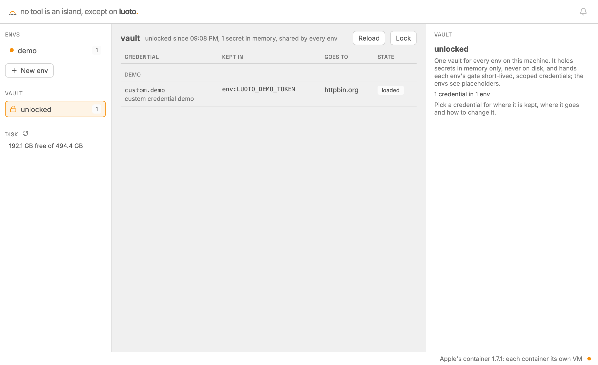
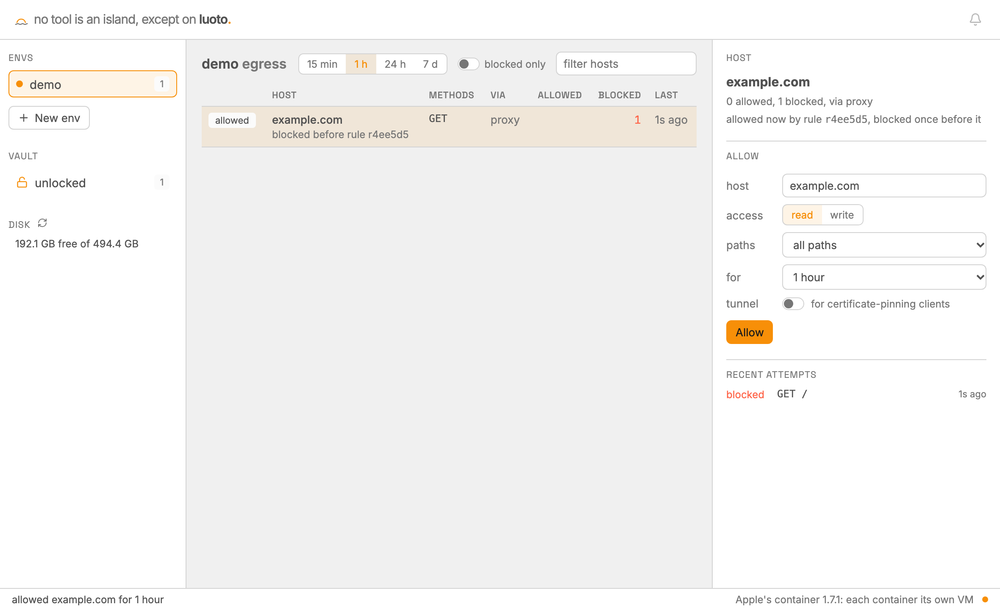

# A first session: from folder to pull request

The overview is the [README](../README.md); step by step, the [guides](guides/README.md).

## 1. Make an env for a project

```console
$ cd ~/dev/my-app
$ luoto init
env `my-app` from ~/dev/my-app
  workspace  copy: the env works on its own copy; changes leave by git push or `luoto pull`
  isolation  gVisor: its own user-space kernel (builds about 1.6× slower)
  presets    debian, github, github-releases, toolchains, npm (package.json)
  toolchains node 24 (.nvmrc)
             installed by mise in the env; the project's files keep deciding versions

Create it? [Y/n/c = customize]
```

luoto read the folder before creating anything: node 24 from `.nvmrc`, the npm registry
because of `package.json`. `Y` copies the folder, git history included, into the env and
starts it; your folder stays as it was. `c` goes through the settings one at a time.

## 2. Give it credentials, without giving them to it

The first `up` asked what the env may do with the folder's remote. To let it push and open
pull requests, make a fine-grained GitHub token for this repository only, with Contents and
Pull requests set to read and write, and give it to the env:

```console
$ luoto repo auth you/my-app
? What can the env do with you/my-app?
  Fetch only, it's public            no token
  Read it, it's private              token with Contents: read
> Read and push, open pull requests  token with Contents + Pull requests: write
```

It then asks where the token is kept (your OS keychain, 1Password, or a reference to another
secret store) and writes this into the env's file, applied at once:

```toml
[credentials.github]
token = "op://Private/github-my-app/token"
repos = ["you/my-app"]
```

luoto reads the secret on your machine and hands it to the vault, which lives outside the
sandbox. Inside, `GH_TOKEN` is a placeholder; the gate puts the real token on requests to
GitHub, for `you/my-app` only, and refuses pushes to `main` and `master`
(`protected_branches`). Claude Code's token goes the same way: `luoto agent add claude` (next
step) asks for it (`claude setup-token` on your machine makes one from your Claude
subscription), and `luoto agent auth claude` changes it. Other changes, each a command:
[Changing an env](guides/changing-an-env.md).

`luoto ui` shows which credentials an env has, never their values:

<picture>
  <source media="(prefers-color-scheme: dark)" srcset="screenshots/vault-dark.png">
  
</picture>

## 3. Let an agent work

```sh
luoto agent add claude          # installs Claude Code in the env
luoto agent run claude --yolo   # no permission prompts: the sandbox is the boundary
```

Ask it to fix something small and open a pull request. Or do it yourself: `luoto open`
attaches Zed, VS Code or Cursor over SSH, and `luoto shell` opens a terminal.

## 4. Run it and open it

Start the project as usual in the env's terminal: `yarn dev` prints
`http://localhost:5173/`, and clicking it opens the app in your browser. The background
watcher (started by `up`, `shell` and editor sessions; `luoto logs watcher` shows its log)
forwards each port a server in the env listens on, 1024–32767, to the same port on your
machine for as long as it listens. It goes through
the runtime rather than a network path, so servers bound to the env's own localhost work too;
a port already taken here is skipped (`luoto forward LOCAL:ENV` maps it elsewhere).
`luoto status` and the env's panel in `luoto ui` list the forwarded ports as links.

## 5. See what it reached

`luoto ui` (or `luoto egress`) lists every host the env tried: npm and GitHub allowed,
anything else blocked, with a scoped allow next to it. One click lets a host through, for an
hour if you like:



An agent that needs a host asks with `sandbox request`; only you can approve it, on your
machine (`luoto approve`, which asks you to accept the rule's risks like `luoto allow` does;
`--force` accepts them without asking). You can grant less than it asked, never more:
`--read` for a write request, `--method`, `--path` within its paths. A protocol other than
HTTP(S) is a host and port (`sandbox request db.example.com:5432`), which approved becomes an
uninspected tunnel, a risk you confirm. It asks the same way for a system package or a
toolchain the env should keep (`sandbox request --package postgresql-client`,
`--tool node@24`): approving installs it and writes it into the env's `[deps] system` or
`[tools]`, so a recreated container has it too. A plain variable the code needs comes with a
value to confirm (`sandbox request --var RUST_LOG=debug`); a secret you add yourself
(`luoto var set`, [environment variables](guides/env-vars.md)).

Trying luoto on a project whose needs you don't know yet: `luoto init --open` (or `luoto
egress open` later) lets the env reach any HTTP(S) host for an hour (`--open=2h`, `--for 2h`
for longer), every request still logged. `luoto egress keep` then offers presets that cover
what it reached, else a rule per host, and when the hour ends the env is default-deny again.
Hosts that get your credentials keep to their rules throughout, and muted hosts stay denied.

## 6. Bring files back and stop

`luoto pull` brings files back to your folder when you need them there; it holds back git
hooks and other files your own tools would run. `luoto down` stops the env, and it stops by
itself after 30 minutes with nothing running in it (`idle_stop`). With podman on macOS and
Windows, luoto's VM stops too once no env has run for as long; on Apple's `container` each
container is a VM of its own, which stops with its env. `luoto up` brings it back in about
10 s and unlocks the vault anew.
