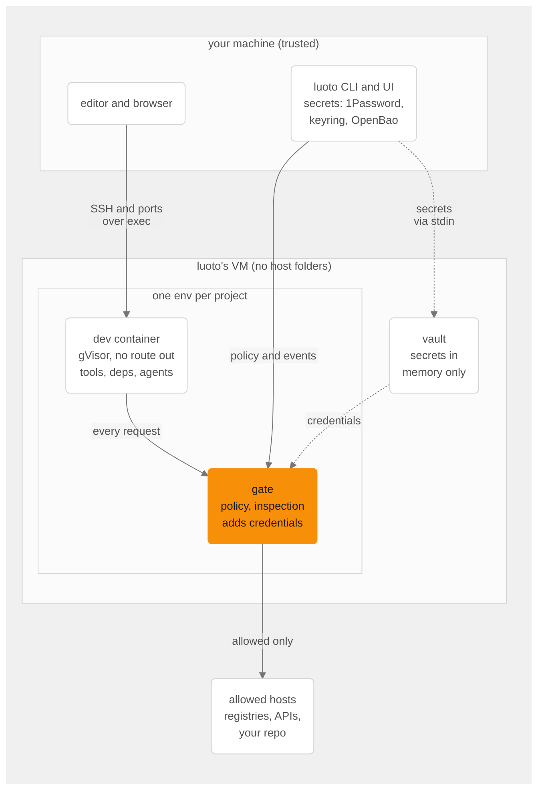

# How it works

The overview is the [README](../README.md); step by step, the [guides](guides/README.md).

- **Default deny.** The sandbox has no route out. HTTP(S) leaves only through the env's gate,
  which applies per-host, per-method, per-path rules; read-only is enforced (a `PUT` to a
  registry you allowed for reads is refused). The other ways out pass through uninspected:
  tunnels you grant (`luoto allow --tunnel`) and git over SSH to the hosts an SSH credential
  names.
- **Every attempt is visible.** The UI and `luoto egress` show each host the sandbox tried to
  reach (allowed, blocked, or only looked up) with a one-click scoped allow.
- **Agents know where they are.** Claude Code, OpenCode, Codex, Copilot CLI and Antigravity
  CLI get a briefing and an MCP server: they can see the policy and ask you for access instead
  of guessing.

`SECURITY.md` has the threat model, including what luoto does not stop.

## Platforms

| host                                  | runtimes                                               | boundary                                                                                                                                                                                      |
| ------------------------------------- | ------------------------------------------------------ | --------------------------------------------------------------------------------------------------------------------------------------------------------------------------------------------- |
| macOS                                 | podman (recommended), Docker Desktop, OrbStack, Colima | podman: luoto's own VM, with none of your folders mounted, and gVisor. Docker: its VM, which shares your folders, and plain containers                                                        |
| Windows (not yet verified end to end) | podman (Hyper-V or WSL2), Docker Desktop               | as on macOS; a WSL2 VM can still see `C:\` (`luoto doctor` reports it), so prefer Hyper-V                                                                                                     |
| Linux                                 | rootless podman (recommended), Docker                  | no VM. podman: gVisor when `runsc` is installed (`luoto setup` finds it). Docker: plain containers, or gVisor registered with Docker and `oci_runtime = "runsc"` under an env's `[resources]` |

With podman, dev containers run on [gVisor](https://gvisor.dev), a user-space kernel (on Linux
once `runsc` is installed). It costs time wherever a tool touches many files. A Rust + Vite
monorepo in luoto's VM (6 CPUs):

| step                                       | gVisor | container |
| ------------------------------------------ | ------ | --------- |
| `yarn install`                             | 4.6 s  | 3.1 s     |
| `vite build`                               | 2.9 s  | 2.0 s     |
| `cargo build` (debug, after `cargo clean`) | 36 s   | 21 s      |

gVisor is the default, and the right choice for anything that runs code you haven't read:
new dependencies, unfamiliar repos, agents in yolo mode. `isolation = "container"` in an env's
config (or `luoto init --isolation container`) suits an env whose day is spent in native
builds; it shares the VM's kernel, so an exploit from inside reaches the VM
([SECURITY.md](../SECURITY.md#residual-risks)).

Podman on macOS runs one VM at a time, so luoto's replaces your default podman machine while
you use luoto: `luoto up` asks before switching.
